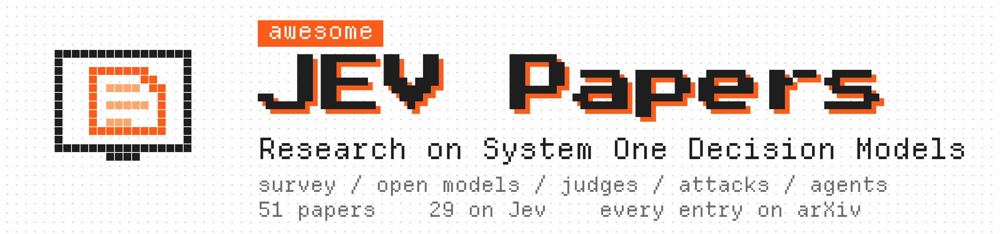

<div align="center">

<picture>
  <source media="(prefers-color-scheme: dark)" srcset="assets/jev-papers-dark.png">
  
</picture>

# Awesome JEV Papers [](https://awesome.re)

> Research papers on Jev, TypeSafe's System One model, and the open models built in its shape.

[](https://omnijev.github.io/awesome-jev-papers/)
[](https://omnijev.github.io/awesome-jev-gallery/)


[](LICENSE)

🧭 Survey · 🔓 Open models · 📏 Benchmarks · 📊 Judges · 🎯 Calibration · 🛡️ Robustness · 🤖 Agents · 🌍 Applications

</div>

---

## Contents

- [🔥 News](#-news)
- [🧭 Survey & Position](#-survey--position) (5)
- [🔓 Open Decision Models](#-open-decision-models) (57)
- [📏 Benchmarks & Evaluations](#-benchmarks--evaluations) (17)
- [📊 Jev as Judge & Classifier](#-jev-as-judge--classifier) (19)
- [🎯 Calibration & Consistency](#-calibration--consistency) (22)
- [🛡️ Robustness & Attacks](#-robustness--attacks) (18)
- [🤖 Agents & Systems](#-agents--systems) (49)
- [🌍 Applications](#-applications) (41)
- [🔗 Related Lists](#-related-lists)

---

## 🔥 News

🆕 **2026-10-25.** We added 78 Jev papers. PRs welcome.

🆕 **2026-10-14.** We added 121 Jev papers from the past two weeks. PRs welcome.

🚀 **2026-09-28 · Launch.** 29 papers on Jev from the first two weeks after its release on 15 September. Every entry is checked against its arXiv page.

💡 **Ongoing · PRs welcome.** A new Jev paper on arXiv? Open a pull request with the arXiv link.

---

## 🧭 Survey & Position

Surveys, systematizations and position papers on Jev and typed decision models.

- [Multimodal Reranking Is a System One Decision](https://arxiv.org/abs/2610.28435), "Multimodal Reranking Is a System One Decision".  [](https://github.com/Ryenhails/rerank-as-decision) [](https://ryenhails.github.io/rerank-as-decision/) [](https://huggingface.co/papers/2610.28435)
- [SoK: Semantic Decision Engines](https://arxiv.org/abs/2610.06425), "SoK: Semantic Decision Engines in Network Control Loops".  [](https://github.com/OniReimu/SoK-JEV) [](https://delong-l.github.io/Jev-Research/) [](https://huggingface.co/papers/2610.06425)
- [Judgement in the Age of Jev](https://arxiv.org/abs/2610.01231), "Judgement in the Age of Jev: From Evaluation Scarcity to Evaluation Abundance". 
- [Typed Decision Models Audit](https://arxiv.org/abs/2609.32160), "Typed Decision Models: An Early Evidence Audit and Evaluation Checklist". 
- [Jev in the Wild](https://arxiv.org/abs/2609.30216), "Jev in the Wild: A Data-Driven Analysis of the Jev Model's Functionality, Applications and Ecosystem".  [](https://github.com/godxue1/Jev_in_the_wild) [](https://huggingface.co/papers/2609.30216)

---

## 🔓 Open Decision Models

Open models, training recipes and inference methods that rebuild the System One shape: declared options in, one probability per option out.

- [RetiJev](https://arxiv.org/abs/2610.30947), "RetiJev: Fast and Source-Grounded Ophthalmic Decision Models".  [](https://github.com/Awenbocc/RetiJev)
- [VX-One](https://arxiv.org/abs/2610.30090), "VX-One: Typed, Calibrated Decision Heads for Real-Time Perimeter Triage - An empirical study of unknown-attack honesty, cascade gray zones, and calibration under drift".  [](https://github.com/vectrayx/vx-one) [](https://huggingface.co/jsantillana/vx-one) [](https://vectrayx.com) [](https://huggingface.co/papers/2610.30090)
- [Our Own Jev](https://arxiv.org/abs/2610.29052), "Our Own Jev: Typed Decisions in One Forward Pass, from an In-House Judge to Open LoRA Models". 
- [Clinical System One](https://arxiv.org/abs/2610.27099), "A general-purpose System One decision model for clinical records". 
- [TimesJev](https://arxiv.org/abs/2610.26002), "TimesJev: Thinking Fast on Time Series with System 1 Sufficiency". 
- [UniJev](https://arxiv.org/abs/2610.25784), "UniJev: Separating Accuracy from Calibration in Trimodal System One Decision Models".  [](https://github.com/wjnwjnwj/UniJev)
- [Narrow Decision Models](https://arxiv.org/abs/2610.25553), "Narrow Decision Models: A System-1 Architecture for Calibrated, Typed Decisions". 
- [P(Yes)](https://arxiv.org/abs/2610.25474), "P(Yes): 15× Improvements via Test-Time Scaling of Decision Models".  [](https://github.com/tear-labs/pyes-search) [](https://research.tearlabs.ai/pyes-search/)
- [System X](https://arxiv.org/abs/2610.25456), "System X: An LLM Decision Model That Replies from Its Own KV Cache".  [](https://huggingface.co/TuringLogic/system-x) [](https://huggingface.co/papers/2610.25456)
- [DKnown-Jev](https://arxiv.org/abs/2610.24358), "DKnown-Jev: Fine-Tuning and Evaluation of a JEV-Style Model for Tasks Involving Normative Knowledge". 
- [Chinese Decision](https://arxiv.org/abs/2610.23170), "Chinese Decision: A Family of Language Models for Single-Pass Probabilistic Decision-Making".  [](https://github.com/yanqiangmiffy/chinese-decision)
- [ASOM](https://arxiv.org/abs/2610.22401), "Audio System One Model: Typed Probabilistic Perception of Emotion in Speech". 
- [MJev-Spatial](https://arxiv.org/abs/2610.22276), "MJev-Spatial: System One Spatial Intelligence via Native Attention Matching".  [](https://github.com/Fr0zenCrane/MJev-Spatial) [](https://huggingface.co/mindlab-research/MJev-Spatial-4B) [](https://fr0zencrane.github.io/mjev-spatial-project/) [](https://huggingface.co/papers/2610.22276)
- [Intern-Decision](https://arxiv.org/abs/2610.22131), "Intern-Decision: Efficient Multimodal Decision Making with Autoregressive Masked Language Modeling".  [](https://github.com/InternLM/Intern-Decision) [](https://huggingface.co/internlm/Intern-Decision-4B) [](https://huggingface.co/papers/2610.22131)
- [Prism-1](https://arxiv.org/abs/2610.22066), "Prism-1: Position- and Rival-Independent Scoring for System One Models". 
- [Qwen-Audio-Jev](https://arxiv.org/abs/2610.21614), "Qwen-Audio-Jev: A Unified Interface for Audio Decisions".  [](https://huggingface.co/papers/2610.21614)
- [VoxTurn](https://arxiv.org/abs/2610.21150), "VoxTurn: Answering Several Turn-Taking Questions in One Pass with One Model". 
- [LEV](https://arxiv.org/abs/2610.20951), "LEV: Thinking Fast and Deep with Looped Decision Models".  [](https://github.com/OpenLAIR/lev) [](https://huggingface.co/songdj/Lev-2.6B) [](https://openlair.github.io/lev/) [](https://huggingface.co/papers/2610.20951)
- [Verdict](https://arxiv.org/abs/2610.20778), "Verdict: Encode Once, Decide Many".  [](https://github.com/LEC-AI/verdict)
- [Selective Reasoning](https://arxiv.org/abs/2610.19644), "Selective Reasoning for Typed Decision Models: When to Start, Read, and Stop".  [](https://github.com/binzheng-joey/selective-reasoning)
- [AgriJev](https://arxiv.org/abs/2610.19478), "AgriJev: Efficient Agricultural Candidate Scoring with Multi-Scale Adapted Models". 
- [Jeva](https://arxiv.org/abs/2610.18773), "Jeva: System One Models from First Principles".  [](https://github.com/LiQiiiii/Jeva) [](https://huggingface.co/LIQIIIII/Jeva-4B) [](https://liqiiiii.github.io/Jeva/) [](https://huggingface.co/papers/2610.18773)
- [VideoJev](https://arxiv.org/abs/2610.18615), "VideoJev: System One Model for Video Understanding and Interaction".  [](https://github.com/MCG-NJU/VideoJev) [](https://huggingface.co/ZhuYuhan/VideoJev-4B) [](https://mcg-nju.github.io/VideoJev/) [](https://huggingface.co/papers/2610.18615)
- [StartLux-Decision](https://arxiv.org/abs/2610.17309), "StartLux-Decision: AutoThink Decision Models with Reinforcement Learning for Calibrated Deliberative Decisions".  [](https://github.com/StartLuxLabs/StartLux-Decision) [](https://huggingface.co/startlux-models) [](https://decision.startlux.com/) [](https://huggingface.co/papers/2610.17309)
- [Releasing the Inner Jev](https://arxiv.org/abs/2610.17205), "Releasing the Inner Jev: A Simple Recipe for Open Decision Models".  [](https://huggingface.co/papers/2610.17205)
- [FunDM](https://arxiv.org/abs/2610.17175), "FunDM: Cheap & Label-Free Decision Models from Frozen Language Models".  [](https://github.com/Ujjawal-K-Panchal/FunDM)
- [CalOn](https://arxiv.org/abs/2610.17113), "Calibrated Typed Decisions for Entity, Relation, and Event Extraction".  [](https://github.com/extraordinarylab/calon) [](https://huggingface.co/papers/2610.17113)
- [CT0](https://arxiv.org/abs/2610.16550), "CT0: Cybersecurity Transformer".  [](https://huggingface.co/aliasrobotics/alias3-micro-1026) [](https://huggingface.co/papers/2610.16550)
- [Large Decision Models](https://arxiv.org/abs/2610.15501), "Large Decision Models: Repurposing Large Language Models as Single-Pass Decision Makers".  [](https://github.com/JianhuiWei7/LDM)
- [FastJEV](https://arxiv.org/abs/2610.11379), "FastJEV: Understanding Redundancy for Compact JEV Inference".  [](https://huggingface.co/papers/2610.11379)
- [MetaEncoder](https://arxiv.org/abs/2610.11316), "MetaEncoder: Exploring the Limit of Bi-Encoders for Multimodal System One Decision Making with Natural Language Interface".  [](https://huggingface.co/facebook/meta-encoder) [](https://huggingface.co/papers/2610.11316)
- [SanSi](https://arxiv.org/abs/2610.07730), "SanSi: A Looped Typed Decision Model for System 1.5 Thinking".  [](https://github.com/minnesotanlp/Sansi) [](https://huggingface.co/minnesotanlp/SanSi-2.6B) [](https://minnesotanlp.github.io/Sansi/) [](https://huggingface.co/papers/2610.07730)
- [JevCascade](https://arxiv.org/abs/2610.07716), "JevCascade: Readout Stability and Inference-Time Compute Allocation for Prefill-Only Decision Models".  [](https://huggingface.co/papers/2610.07716)
- [ufakzeka-karar](https://arxiv.org/abs/2610.06744), "ufakzeka-karar: An Open Turkish Typed-Decision Model with Order-Invariant Option Scoring".  [](https://github.com/ufakai/ufakzeka-karar) [](https://huggingface.co/ufakai/ufakzeka-karar) [](https://huggingface.co/papers/2610.06744)
- [SearchJev](https://arxiv.org/abs/2610.05107), "SearchJev: A Fast and Calibrated System-1 Model for Search Agents".  [](https://github.com/EvoScientist/SearchJev) [](https://huggingface.co/SearchJev/SearchJev-0.8B) [](https://huggingface.co/papers/2610.05107)
- [SecJev](https://arxiv.org/abs/2610.03073), "SecJev: Bringing Security Expertise to System One Decision Models". 
- [SBERT2S1](https://arxiv.org/abs/2610.02486), "From Retrieval to Typed Decisions: Calibrated System One Models from Biomedical Sentence Encoders".  [](https://github.com/pritamdeka/sbert2s1) [](https://huggingface.co/pritamdeka/S1-PubMedBERT) [](https://huggingface.co/papers/2610.02486)
- [LLM-as-Jev](https://arxiv.org/abs/2610.02076), "LLM-as-Jev: LLMs Are Already Jev-Style Decision Models -- When and How to Fine-Tune Them".  [](https://huggingface.co/papers/2610.02076)
- [Block-Causal Decision Models](https://arxiv.org/abs/2610.01601), "Permutation-Robust Decision Modeling with Candidate-Independent Block-Causal Attention".  [](https://github.com/guyAmit/ci-decision-models) [](https://huggingface.co/Guy-Amit/qwen3-4b-ci-decision-4096-poc) [](https://huggingface.co/papers/2610.01601)
- [AudioJev](https://arxiv.org/abs/2610.01293), "AudioJev: Direct Audio Decisions with Order-Calibrated Probabilities".  [](https://github.com/SihanLv/AudioJev-Inference) [](https://huggingface.co/shlv/AudioJev) [](https://huggingface.co/papers/2610.01293)
- [AnyJev](https://arxiv.org/abs/2610.00831), "AnyJev Technical Report".  [](https://github.com/nokia-applied-research/AnyJev) [](https://huggingface.co/papers/2610.00831)
- [OmniMed-Jev](https://arxiv.org/abs/2610.00381), "OmniMed-Jev: Calibrating LVLM Confidence for Trustworthy Medical Multimodal Decisions via System One".  [](https://huggingface.co/xmutly/OmniMed-Jev-4B) [](https://huggingface.co/papers/2610.00381)
- [Bongard](https://arxiv.org/abs/2609.39111), "Bongard: Training Machine Intuition".  [](https://huggingface.co/AgentBull/bongard-mini) [](https://huggingface.co/papers/2609.39111)
- [OpenJev-RLCD](https://arxiv.org/abs/2609.38850), "OpenJev-RLCD: A Working RLCD Implementation".  [](https://github.com/ZimmyGao/openjev-rlcd) [](https://huggingface.co/papers/2609.38850)
- [Certo](https://arxiv.org/abs/2609.37832), "Can a Cacheable Decision Model Follow Rules?".  [](https://huggingface.co/papers/2609.37832)
- [Chinese-Jev](https://arxiv.org/abs/2609.36965), "Chinese-Jev: Bringing System One Model to Chinese-Language Tasks".  [](https://github.com/gulucaptain/Chinese-Jev) [](https://gulucaptain.github.io/Chinese-Jev/) [](https://huggingface.co/papers/2609.36965)
- [Dyad](https://arxiv.org/abs/2609.36116), "Dyad: Extending Large Language Models with Native Typed Decision-Making". 
- [Koa-decision](https://arxiv.org/abs/2609.36115), "Koa-decision: Fast and Consistent Structured Decision Making with Generative LLMs". 
- [PACT](https://arxiv.org/abs/2609.35865), "PACT: Pairwise-Anchored Calibrated Tuning for Single-Token Typed Decisions".  [](https://github.com/BennyLinntu/PACT-Pairwise-Anchored-Calibrated-Tuning-for-Single-Token-Typed-Decisions) [](https://huggingface.co/papers/2609.35865)
- [JET](https://arxiv.org/abs/2609.33874), "JET: Justification Evaluation in Transformer".  [](https://github.com/yet-another-ai/jet) [](https://huggingface.co/papers/2609.33874)
- [SubJudge](https://arxiv.org/abs/2609.33282), "Multi-Dimensional Comparative Scale Construction for Efficient Personalized Subjective Judgment in High-Traffic Applications".  [](https://github.com/Longchentong/SubJudge)
- [LAVOIR](https://arxiv.org/abs/2609.30706), "LAVOIR: Teaching a Single-Pass Decision Encoder When and What to Ask with Amortized Value of Information".  [](https://github.com/moganai/lavoir) [](https://huggingface.co/moganai/lavoir) [](https://moganai.github.io/lavoir-web/) [](https://huggingface.co/papers/2609.30706)
- [PixelJev](https://arxiv.org/abs/2609.29283), "From Text Decisions to Pixels: An Study of Jev-Style Visual Choice Model". 
- [NumericJev](https://arxiv.org/abs/2609.28587), "NumericJev: Jev-like LLM Numerical Decoding with Multiway Decision Trees". 
- [Visual Jev](https://arxiv.org/abs/2609.25845), "Visual Jev: Accurate and Efficient Decisions from Shared Visual Context".  [](https://github.com/guanxuyu-sv/Visual-Jev) [](https://huggingface.co/papers/2609.25845)
- [JevLite](https://arxiv.org/abs/2609.23959), "Open-Jev Judgments on CallScreenBench: Calibrated One-Pass Scam Screening with a Small Language Model". 
- [this-that-model-1.0](https://arxiv.org/abs/2609.23886), "this-that-model-1.0: A typed decision model that decides in 30 ms, for a millionth of a cent".  [](https://github.com/FLock-io/this-that-model) [](https://huggingface.co/flock-io/this-that-model-1.0) [](https://huggingface.co/papers/2609.23886)

---

## 📏 Benchmarks & Evaluations

Benchmarks and broad evaluations of Jev and other typed decision models.

- [Vietnamese Text Classification](https://arxiv.org/abs/2610.31422), "How Well Do Decision Models Transfer to Vietnamese? An Empirical Study of Text Classification". 
- [DecisionPivot](https://arxiv.org/abs/2610.28522), "DecisionPivot: A Diagnostic Benchmark for Decision Models in LLM Systems".  [](https://github.com/StartLuxLabs/DecisionPivot) [](https://huggingface.co/papers/2610.28522)
- [What Can't Jev Decide?](https://arxiv.org/abs/2610.24929), "What Can't Jev Decide? Probing the Limits of One-Pass Decision Models". 
- [System1-Arena](https://arxiv.org/abs/2610.21244), "System1-Arena: Which Decisions Can Be Left to System 1?".  [](https://github.com/TianyuCodings/S1-Arena) [](https://tianyucodings.github.io/S1-Arena) [](https://huggingface.co/papers/2610.21244)
- [Are AI Decision Models Biased?](https://arxiv.org/abs/2610.19619), "Are AI Decision Models Biased? A Case Study of Jev". 
- [Jev-ToM](https://arxiv.org/abs/2610.18610), "Jev-ToM: Evaluating Theory of Mind in Typed Decision Models".  [](https://github.com/HKUST-KnowComp/Jev-ToM)
- [ProbabilityBench](https://arxiv.org/abs/2610.17016), "ProbabilityBench: Model Evaluation and Calibration with Exact Ground-Truth Uncertainty".  [](https://github.com/ishida-lab/ProbabilityBench) [](https://ishida-lab.github.io/blog_probabilitybench.html) [](https://huggingface.co/papers/2610.17016)
- [Choice2Seq](https://arxiv.org/abs/2610.16191), "Correct Choices, Failed Sequences: Choice2Seq Benchmarks Correctness Retention Across Output Interfaces". 
- [Indonesian Regional Languages](https://arxiv.org/abs/2610.14112), "Does System One Transfer? Calibrated Typed-Decision Models, Label Budgets, and Translation for Indonesian Regional Languages".  [](https://github.com/tnromy/evaluating-system-one-models-for-indonesian-regional-languages)
- [Specialized vs. General-Purpose](https://arxiv.org/abs/2610.11978), "Specialized Decision Models vs. General-Purpose LLMs: Benchmarking Jev Across Knowledge, Reasoning, and Multilingual Tasks". 
- [TypedBench](https://arxiv.org/abs/2610.11392), "TypedBench: A Benchmark for Calibration, Framing Sensitivity, and Cost in System One Decision Models".  [](https://huggingface.co/papers/2610.11392)
- [GraphDecisionBench](https://arxiv.org/abs/2610.06354), "GraphDecisionBench: Benchmarking System One Models on Graph Tasks".  [](https://github.com/VictorYXL/GraphDecisionBench) [](https://huggingface.co/papers/2610.06354)
- [JEVal](https://arxiv.org/abs/2610.03935), "General Decision Models: Benchmarking and Insights Beyond Jev".  [](https://huggingface.co/papers/2610.03935)
- [HakemBench](https://arxiv.org/abs/2610.02293), "HakemBench: A Turkish Benchmark of Typed Decisions".  [](https://github.com/ufakai/hakembench) [](https://huggingface.co/papers/2610.02293)
- [Decision Models for Decision Gates](https://arxiv.org/abs/2610.00346), "Benchmarking System One decision models against trained classifiers and language models for automated decision gates".  [](https://huggingface.co/papers/2610.00346)
- [Benchmarking Jev](https://arxiv.org/abs/2609.37647), "Evaluating and Benchmarking the System One Model Jev".  [](https://huggingface.co/papers/2609.37647)
- [Calibrated to Whom?](https://arxiv.org/abs/2609.36399), "Calibrated to Whom? Persona and Language Effects on Cultural Values in JEV". 

---

## 📊 Jev as Judge & Classifier

Jev measured against LLM judges, classifiers and human labels.

- [Clinical AI Judges](https://arxiv.org/abs/2610.28826), "Decision language models as affordable and rapid alternatives to LLM judges of clinical generative AI". 
- [Brazilian Portuguese IR](https://arxiv.org/abs/2610.23346), "Jev-as-a-Judge for Brazilian Portuguese Information Retrieval: Relevance Assessment and Reranking". 
- [RAG Claim Verification](https://arxiv.org/abs/2610.20634), "Jev-as-a-Judge for RAG Claim Verification: Confidence-Gated Cascading Between a Non-Generative Verifier and a Frontier LLM".  [](https://github.com/adorosario/jev-rag-claim-verification) [](https://huggingface.co/papers/2610.20634)
- [PRISM](https://arxiv.org/abs/2610.18389), "PRISM: Calibrating Black-Box Judges with Counterfactual Probes". 
- [Typed Decision Models as Judges](https://arxiv.org/abs/2610.18122), "Cheap, Consistent, Calibrated, but Biased? Typed Decision Models as Judges". 
- [Stance Detection](https://arxiv.org/abs/2610.11901), "Can Decision Models Understand Stance? Evaluating Jev Against General-Purpose LLMs". 
- [Same-Number Citation Swaps](https://arxiv.org/abs/2610.08675), "Same-Number Citation Swaps: Stress-Testing Jev as a Financial Evidence Judge". 
- [Online Moderation](https://arxiv.org/abs/2610.07953), "Benchmarking System One Models in Online Moderation". 
- [CLM-as-a-Judge](https://arxiv.org/abs/2610.07177), "CLM-as-a-Judge: Evaluating an Open Contrastive Decision Model on Public Judge Benchmarks". 
- [To Jev or Not?](https://arxiv.org/abs/2610.03324), "To Jev or Not? Evaluating the Accuracy and Efficiency of Structured Decision Models for Hate-Speech Moderation". 
- [Agent Trace Security Judge](https://arxiv.org/abs/2609.34862), "JEV as a Judge for Agent Trace Security: An Empirical Comparison with Generative LLM Judges". 
- [Agent Security Decisions](https://arxiv.org/abs/2609.33401), "Evaluating System One Models for Agent Security Decisions: Reliability, Calibration, and Selective Automation". 
- [Decision Models as Rubric Judges](https://arxiv.org/abs/2609.29769), "Decision Models vs. LLMs as Rubric Judges: Cheaper, Faster, and Wrong in the Same Places". 
- [Just Ask Jev](https://arxiv.org/abs/2609.29429), "Just Ask Jev: Reinforcement Learning for Calibrated Decisions as a Zero-Shot Detector of AI Alignment Failures".  [](https://github.com/sumleo/RLCDAlignBench) [](https://sumleo.github.io/RLCDAlignBench/) [](https://huggingface.co/papers/2609.29429)
- [Same Scores, Different Decisions](https://arxiv.org/abs/2609.27678), "Same Scores, Different Decisions: Evaluating JEV and Language Models for Legal Document Understanding".  [](https://github.com/ZF-Utokyo/Jev-Benchmark)
- [Jev for Radiology Reports](https://arxiv.org/abs/2609.27607), "Can Jev Judge Radiology Reports? Evaluating a System One Model for Clinical Factuality". 
- [JEV-as-a-Judge](https://arxiv.org/abs/2609.26550), "JEV-as-a-Judge: Accept When Confident, Escalate When Unsure".  [](https://yubol-bobo.github.io/jev-as-a-judge/) [](https://huggingface.co/papers/2609.26550)
- [Jev for Scientific Decisions](https://arxiv.org/abs/2609.24965), "Jev for Scientific Decisions: Evaluating Semantic Choices and Their Consequences". 
- [Text Annotation in CSS](https://arxiv.org/abs/2609.24574), "Evaluating Decision Models for Text Annotation in Computational Social Science". 

---

## 🎯 Calibration & Consistency

Whether typed decision probabilities are calibrated, coherent, and stable when the options are reordered, renamed or changed.

- [Which Differences Matter?](https://arxiv.org/abs/2610.30045), "Which Differences Matter? Controlled Tests of Rule Transfer, Joint Reliability, and Information Use in Decision Models". 
- [When Multiple Choices Are Correct](https://arxiv.org/abs/2610.29217), "When Multiple Choices Are Correct: Asymmetric Probability Allocation in Jev and Other Decision Models".  [](https://github.com/Rushab1/gr-jev)
- [Exact Risk Calculations](https://arxiv.org/abs/2610.26797), "Teacher Supervision, Fixed Representations and Calibration: Exact Risk Calculations for Candidate-Scoring Decision Models". 
- [Prevalence Shift](https://arxiv.org/abs/2610.26325), "Typed Decision Models under Prevalence Shift: Decision Training, Calibration, and Implicit Priors".  [](https://github.com/AbdulRahmanIqbal/tdm-prevalence-shift)
- [Prompt-Injection Deferral](https://arxiv.org/abs/2610.20907), "From Detection to Decision: Calibration and Deferral for Prompt-Injection Detection". 
- [Lost in the Fallback](https://arxiv.org/abs/2610.19856), "Lost in the Fallback: How Reliably Do Typed Decision Models Use Fallback Options?". 
- [Risk-Budgeted Decisions](https://arxiv.org/abs/2610.19811), "Calibration and Risk-Budgeted Decisions with System One Models". 
- [Recalibrating Many Questions](https://arxiv.org/abs/2610.18488), "Recalibrating Many Questions with Few Labels: Minimax Rates and Identification Limits". 
- [Consider, Then Choose](https://arxiv.org/abs/2610.18233), "Consider, Then Choose: Order-Invariant Decisions in System One Models".  [](https://huggingface.co/papers/2610.18233)
- [Irrelevant Alternatives](https://arxiv.org/abs/2610.16655), "Does a Hosted Decision Model Respect Irrelevant Alternatives? A Pre-Registered Test of Option-Set Dependence in Jev".  [](https://huggingface.co/papers/2610.16655)
- [The Company a Question Keeps](https://arxiv.org/abs/2610.14631), "The Company a Question Keeps: Auditing Open Jev-Style Models for Retrieval". 
- [Candidate Coverage and Rejection](https://arxiv.org/abs/2610.03387), "Benchmarking candidate coverage and rejection policy transfer in typed decision models".  [](https://github.com/luckykevvv/Decision_Model_Benchmark)
- [Labels Override Definitions](https://arxiv.org/abs/2610.02586), "Labels Override Definitions in Jev-Style Typed Decision Models".  [](https://huggingface.co/papers/2610.02586)
- [Beyond Answer Confidence](https://arxiv.org/abs/2610.01006), "Beyond Answer Confidence: A Controlled Audit of Self-Knowledge in a Black-Box Decision Model".  [](https://github.com/Syntheme/beyond-answer-confidence)
- [Rejection Bottleneck](https://arxiv.org/abs/2609.39496), "When the Right Answer Is Missing: An Arithmetic-Dependent Rejection Bottleneck in Jev". 
- [Ordinal-Scale Bias](https://arxiv.org/abs/2609.38827), "More Choices, Fewer Decisions: Ordinal-Scale Bias in JEV-like Direct-Decision Models".  [](https://github.com/Glax147/jev_ordinal_scale_bia) [](https://huggingface.co/papers/2609.38827)
- [Probability Contracts](https://arxiv.org/abs/2609.37470), "Probability Contracts: Accuracy, Coherence, and Decisions Across LLM Interfaces". 
- [Sys1Cal-v1](https://arxiv.org/abs/2609.35342), "Jev thinks "I don't know", but doesn't say it: Introducing Sys1Cal-v1 Dataset for Probability Calibration".  [](https://github.com/little-g-ai/Sys1Cal-v1) [](https://huggingface.co/papers/2609.35342)
- [Do System One Decisions Add Up?](https://arxiv.org/abs/2609.33971), "Do System One Decisions Add Up? A Study of Probabilistic Coherence".  [](https://github.com/samanjoy2/system-one-coherence) [](https://huggingface.co/papers/2609.33971)
- [Laya as a Typed Assessor](https://arxiv.org/abs/2609.33843), "Laya as a Typed Probabilistic Assessor: An Independent Reproduction and a Preregistered Study of Calibration and Selective Escalation". 
- [Probability Axioms](https://arxiv.org/abs/2609.33209), "Beyond Calibration: Do a Typed-Decision Model's Probabilities Obey the Probability Axioms?".  [](https://github.com/bro789/typed-decision-coherence) [](https://huggingface.co/papers/2609.33209)
- [Biosecurity Audit](https://arxiv.org/abs/2609.30454), "Auditing System-1 Models on Biosecurity-Relevant Benchmarks: Calibration, Selective Prediction, and Permutation Instability in a Non-Generative Model". 

---

## 🛡️ Robustness & Attacks

How typed decisions move under context changes, option renaming, prompt injection and adversarial search.

- [Claim Laundering](https://arxiv.org/abs/2610.25947), "Claim Laundering: When Agent Decision Models Trust Records Over Reality". 
- [A Cue's Hidden Price](https://arxiv.org/abs/2610.25843), "A Cue's Hidden Price: Auditing Seller Influence on AI Shoppers". 
- [TUPLE-Bench](https://arxiv.org/abs/2610.23668), "TUPLE-Bench: Evaluating and Mitigating Privacy-Utility Trade-offs in Typed Decision Models".  [](https://qiaoyuan-zheng.com/TUPLE-Bench/) [](https://huggingface.co/papers/2610.23668)
- [Literal Lock-In](https://arxiv.org/abs/2610.22526), "Literal Lock-In: How Test Language Shifts Literal Attraction in Typed Decision Models on Bengali Idioms".  [](https://github.com/sakhadib/literal-lock-in) [](https://huggingface.co/papers/2610.22526)
- [JSB](https://arxiv.org/abs/2610.19971), "Diagnose Before You Refine: Multi-Dimensional Judge Feedback for Query-Efficient Jailbreak Attacks". 
- [Typed Decisions on Tabular Data](https://arxiv.org/abs/2610.19536), "Typed Decision Models on Tabular Data". 
- [DecisionRobust](https://arxiv.org/abs/2610.19118), "DecisionRobust: Benchmarking Robustness for JEV Style Decision Models Across Text and Vision".  [](https://github.com/Yifan-Lan/DecisionRobust) [](https://yifan-lan.github.io/DecisionRobust/) [](https://huggingface.co/papers/2610.19118)
- [Nudge the Judge](https://arxiv.org/abs/2610.18612), "Nudge the Judge: Uncovering Program Decision Hijacking in Real-World Jev Applications".  [](https://github.com/xiaoxiaohg8d/JevProbe-)
- [Same Attack, Different Judge](https://arxiv.org/abs/2610.17820), "Same Attack, Different Judge: A First Controlled Adversarial Comparison of Jev, LLM Judges, and Purpose-Built Safety Classifiers". 
- [Poisoned into Action](https://arxiv.org/abs/2610.15537), "Poisoned into Action: Context Attacks on Typed Decision Workflows".  [](https://github.com/WuXixiong/jev-poisoning-bench)
- [DICE](https://arxiv.org/abs/2610.14404), "DICE: Tilting the Odds through Interface Attackson System One Model". 
- [Option-Channel Attack](https://arxiv.org/abs/2610.12292), "One Word Opens the Gate: The Option-Channel Attack on Typed Decision Models as Agent Guardrails".  [](https://github.com/ArminAzizi98/option-channel-attack)
- [Adversarial Cues in Judges](https://arxiv.org/abs/2610.11436), "Adversarial Cues in Decision Models Used as Judges: The Role of Request Presentation". 
- [Hidden Risks of Jev](https://arxiv.org/abs/2610.04985), "Hidden Risks of Jev: An Empirical Study of Security, Privacy, and Dual Use".  [](https://github.com/shihe98/Security_Privacy_Jev)
- [JevAdvBench](https://arxiv.org/abs/2609.31142), "JevAdvBench: A Benchmark and Black-Box Attacks for Reinforcement Learning for Calibrated Decisions Models".  [](https://JevAdvBench.github.io/JevAdvBench/) [](https://huggingface.co/papers/2609.31142)
- [JevOut](https://arxiv.org/abs/2609.30243), "JevOut: Natural Context Can Flip Decision Models".  [](https://github.com/xzx34/JevOut) [](https://xzx34.github.io/jevout/) [](https://huggingface.co/papers/2609.30243)
- [Decision Hijacking](https://arxiv.org/abs/2609.28613), "Decision Hijacking: Prompt Injection Attacks on Jev's Typed Probabilistic Decisions".  [](https://huggingface.co/papers/2609.28613)
- [Type-Safe Is Not Error-Free](https://arxiv.org/abs/2609.26758), "Type-Safe Is Not Error-Free: Typed Decision Models Follow the Option Name, Not the Definition Bound to It".  [](https://huggingface.co/papers/2609.26758)

---

## 🤖 Agents & Systems

Jev as the fast decision layer inside agents, routers, memory, databases and harnesses.

- [Jev-DLC](https://arxiv.org/abs/2610.31521), "Jev-DLC: Decision-Level Continual Learning from Typed Feedback". 
- [ReDence](https://arxiv.org/abs/2610.30963), "ReDence: A Hybrid Agentic and Decision-Model Framework for Rapid, Evidence-Grounded Detection of Modern Social Engineering Scams". 
- [Scan or Index?](https://arxiv.org/abs/2610.28957), "Scan or Index? large Evidence Coverage, Answer Quality, and Cost in Long-Document RAG". 
- [WorldStream](https://arxiv.org/abs/2610.28827), "WorldStream: Streaming Interactive 3D Worlds with Hierarchical Planning and Persistent State".  [](https://github.com/krennic999/WorldStream) [](https://krennic999.github.io/WorldStream/) [](https://huggingface.co/papers/2610.28827)
- [Compaction for Later Questions](https://arxiv.org/abs/2610.27301), "Evaluating Context Compaction on the Questions That Come Later". 
- [SOMA](https://arxiv.org/abs/2610.26793), "SOMA: Continuous Monitoring and Intervention for System Two Reasoning with System One Models". 
- [NIOCIS](https://arxiv.org/abs/2610.25985), "NIOCIS: Typed-Decision Next-Hop Routing with Node-Conditioned Option Spaces for Tool-Use Agents".  [](https://github.com/geilihan/niocis)
- [Truncated Reasoning Under a Budget](https://arxiv.org/abs/2610.25768), "Truncated Reasoning Under a Budget: Evaluating System-1 Models as Decision-makers". 
- [Good Judgment, Bad Advice](https://arxiv.org/abs/2610.24649), "Good Judgment, Bad Advice: Decision-Model Controllers Raise Agent Cost Without Improving Success".  [](https://github.com/namanvats/decision-model-controllers) [](https://huggingface.co/papers/2610.24649)
- [Jarvis](https://arxiv.org/abs/2610.23804), "Jarvis: Coordination Deserves a Brain of Its Own in Agentic Interactive Models". 
- [SAG2](https://arxiv.org/abs/2610.22588), "SAG2: Embedding-Free Multi-Hop Retrieval with BM25 and JEV". 
- [JevAgentHarness](https://arxiv.org/abs/2610.21412), "JevAgentHarness: Benchmarking, Deploying and Training Decision Models That Share Control with LLMs".  [](https://github.com/JevAgentHarness/JevAgentHarness) [](https://huggingface.co/JevAgentHarness/AgentDecision-4B) [](https://jevagentharness.github.io/) [](https://huggingface.co/papers/2610.21412)
- [Jev-LiteMAS](https://arxiv.org/abs/2610.21411), "Jev-LiteMAS: Separating Decisions from Generation in Multi-Agent Workflows". 
- [PremiseCheck](https://arxiv.org/abs/2610.21046), "PremiseCheck: Efficient Fact-Checking of Human and AI Peer Reviews".  [](https://github.com/OpenLAIR/PremiseCheck) [](https://openlair.github.io/premisecheck/) [](https://huggingface.co/papers/2610.21046)
- [Source-Judged Compaction](https://arxiv.org/abs/2610.20927), "Prune the Summary, Not the History: Source-Judged Compaction for Long-Horizon Agents".  [](https://github.com/GuanghuiMin/sjc)
- [RealtimeBench](https://arxiv.org/abs/2610.20665), "The World Won't Wait: Evaluating and Teaching Agents Under a Live Clock". 
- [JevCoder](https://arxiv.org/abs/2610.19596), "JevCoder: When Does Decision Delegation Pay Off in Code Repair?". 
- [BLADE](https://arxiv.org/abs/2610.18780), "BLADE: Auditing Information Use for Failure Attribution in LLM Multi-Agent Systems". 
- [Reading Right, Acting Wrong](https://arxiv.org/abs/2610.18579), "Reading Right, Acting Wrong: Diagnosing Decision Failures of System One Models in Agent Loops".  [](https://yubol-bobo.github.io/System_one_model_evaluation/) [](https://huggingface.co/papers/2610.18579)
- [Jev-Guard](https://arxiv.org/abs/2610.18326), "Jev-Guard: Fast Routing and Auditing Agent Actions over Editable Policy Trees". 
- [JevGPT](https://arxiv.org/abs/2610.18272), "JevGPT: Thinking Fast and Slow in Autonomous Research".  [](https://github.com/sunyasheng/JevGPT) [](https://sunyasheng.github.io/projects/JevGPT) [](https://huggingface.co/papers/2610.18272)
- [ProAgent](https://arxiv.org/abs/2610.16967), "Proactive Physical AI through Continuous Observation and Timely Intervention". 
- [Memory-Retirement Gate](https://arxiv.org/abs/2610.15710), "Suggested Is Not Superseded: A Pre-Registered Evaluation of a System-One Model as a Memory-Retirement Gate". 
- [Jevolution](https://arxiv.org/abs/2610.14449), "Jevolution: A Framework for Studying Communication and Collective Dynamics in AI Agents". 
- [Jev in Agent Workflows](https://arxiv.org/abs/2610.13092), "When Faster Decisions Do Not Make Better Agents: An Empirical Study of Jev in Agent Workflows".  [](https://huggingface.co/papers/2610.13092)
- [Jev as Q or Policy](https://arxiv.org/abs/2610.11692), "Can Jev be Your Q or Policy in Reinforcement Learning?".  [](https://huggingface.co/papers/2610.11692)
- [Probabilistic Sensing, Deterministic Authority](https://arxiv.org/abs/2610.10978), "Probabilistic Sensing, Deterministic Authority: Admitting Model-Produced Observations into Sufficiency-Checked Governance Contracts".  [](https://github.com/besanson/gigo-jev-probe)
- [System Switch](https://arxiv.org/abs/2610.09683), "System Switch: When Should a Fast Decision Model Stop and Think?".  [](https://github.com/dexmac221/system-switch) [](https://huggingface.co/papers/2610.09683)
- [S1-MAS](https://arxiv.org/abs/2610.08155), "Token-Efficient Multi-Agent Collaboration via System One-Guided Computational Division of Labor". 
- [When Plans Change Answers](https://arxiv.org/abs/2610.08089), "When Plans Change Answers: Formalizing Cost-Accuracy Optimization for Semantic Queries". 
- [SharedKV-BT](https://arxiv.org/abs/2610.07327), "SharedKV-BT: Node-Local Typed Decisions for Behavior-Tree Agents". 
- [Student-Guided Task Routing](https://arxiv.org/abs/2610.02516), "Student-Guided Teacher Distillation for Efficient LLM Task Routing: Positioning Against Jev-Style System-1 Classifiers". 
- [Fast Models, Slow Evidence](https://arxiv.org/abs/2610.02267), "Fast Models, Slow Evidence: A Paired and Self-Audited Evaluation of System-1 Decision Models for LLM Agent Harnesses".  [](https://github.com/David-DL-Space/sys1-eval)
- [JEVDB](https://arxiv.org/abs/2610.02046), "Prune First, Decide Fast: Scalable Semantic Query Processing with JEVDB". 
- [Code Owns the Simulation](https://arxiv.org/abs/2610.01834), "Code Owns the Simulation, Jev Owns the Evaluation". 
- [JevSpawn](https://arxiv.org/abs/2610.00437), "JevSpawn: Adaptive Agentic Inference through Compositional Action Spaces".  [](https://github.com/Hoyant-Su/JevSpawn) [](https://hoyant-su.github.io/JevSpawn/) [](https://huggingface.co/papers/2610.00437)
- [Mnemon](https://arxiv.org/abs/2609.36059), "Mnemon: Raw Records, Fast Judgments, Slow Thoughts".  [](https://github.com/Grivn/mnemon-memory-agent) [](https://huggingface.co/papers/2609.36059)
- [NavJev](https://arxiv.org/abs/2609.34969), "NavJev: Efficient Vision-Language Navigation via Action-Centric Visual Compression and Discriminative Action-Semantic Memory".  [](https://kai-sheng-caesar.github.io/NavJev/)
- [SeLMRoute](https://arxiv.org/abs/2609.34736), "SeLMRoute: Probabilistic Semantic Evidence for Large Language Model Routing".  [](https://github.com/Indigma-Innovations/SeLMRoute) [](https://huggingface.co/Indigma/SeLMRoute-JEV) [](https://huggingface.co/papers/2609.34736)
- [Selection Replaces Extraction](https://arxiv.org/abs/2609.34227), "When Does Selection Replace Extraction? A Pre-Registered Test of Agent Memory with a Typed Decision Model".  [](https://github.com/ris3abh/Engram) [](https://huggingface.co/papers/2609.34227)
- [COGNIT-Guard](https://arxiv.org/abs/2609.33671), "COGNIT-Guard: Calibrated Standalone Direct-Decision Guardrails with Heterogeneous CPU-NPU Confidence Cascading under Explicit Latency and False-Positive Constraints". 
- [Jev-LDE](https://arxiv.org/abs/2609.33609), "You Only Edit Once: Incentivizing In-Context Capability of LLMs via Local Demonstration Refinement".  [](https://huggingface.co/papers/2609.33609)
- [JevSoup](https://arxiv.org/abs/2609.30922), "JevSoup: System-One Routing for Training-Free LoRA Composition".  [](https://github.com/Leowang980/JevSoup)
- [Jev-Mobile](https://arxiv.org/abs/2609.30186), "Jev-Mobile: Jev as an Executor for Mobile GUI Agents". 
- [Pentest Decision Layers](https://arxiv.org/abs/2609.28940), "Calibrated Decision Models for Autonomous Penetration-Testing Harnesses: JEV and Laya as System One Decision Layers for LLM-Driven Pentest Agents". 
- [Harness Tokenomics](https://arxiv.org/abs/2609.28919), "Harness Tokenomics: A Router for the Enterprise Agentic Control Plane". 
- [JEV-Star](https://arxiv.org/abs/2609.27331), "JEV-Star: Fast, Low-Cost StarCraft II Control with Language-Model Planning".  [](https://github.com/sc2musa/Jev_Star) [](https://huggingface.co/papers/2609.27331)
- [REFLEX](https://arxiv.org/abs/2609.26532), "REFLEX with Jev for Efficient Selective Control in LLM Agents".  [](https://huggingface.co/papers/2609.26532)
- [Jev-Mem](https://arxiv.org/abs/2609.23986), "Jev-Mem: System-One-Controlled Agentic Memory for Efficient AI Agents".  [](https://github.com/libingzheren/Jev-Mem) [](https://huggingface.co/papers/2609.23986)

---

## 🌍 Applications

Jev applied to a domain problem.

- [System 1 Models in Medicine](https://arxiv.org/abs/2610.31315), "The Value of System 1 Models in Medicine". 
- [Jev-GAD](https://arxiv.org/abs/2610.30777), "One Pretrained Decision Model Is Enough for Training-Free Generalist Graph Anomaly Detection". 
- [Commit or Abstain?](https://arxiv.org/abs/2610.29961), "Commit or Abstain? System One Decision Models, LLMs, and Missing Legal Authority".  [](https://github.com/mmikaildemir/commit-or-abstain)
- [S²-MAS](https://arxiv.org/abs/2610.27746), "S²-MAS: A Society-Scale Multi-Agent Simulation Framework with 500 Million Household Persona Agents".  [](https://github.com/KataDavidXD/s2-mas)
- [Decision4Rec](https://arxiv.org/abs/2610.26035), "Decision4Rec: A Jev-Inspired Framework of Decision Models on Knowledge and Active Graphs for Multi-Agent Recommender Systems".  [](https://github.com/marcopoli/decision4rec) [](https://huggingface.co/m-polignano)
- [Clinical Triage](https://arxiv.org/abs/2610.24692), "Native Probability Outputs for Clinical Triage: An Evaluation of Calibration and Decision Accuracy". 
- [Urban Mobility Agents](https://arxiv.org/abs/2610.22407), "Towards Adaptive and Real-Survey-Aligned Simulated Urban Mobility Behaviour of Generative Agents". 
- [System-One Decisions in Medicine](https://arxiv.org/abs/2610.18529), "How Reliable Are System-One Decisions in Medicine? A Comparative Study of Jev, Jev-like Models, and LLMs".  [](https://huggingface.co/papers/2610.18529)
- [SkillScreen](https://arxiv.org/abs/2610.17727), "SkillScreen: High-Recall Screening of Malicious Agent Skills with Decision Models".  [](https://huggingface.co/SkillScreen) [](https://jerroldh.github.io/SkillScreen-webpage/) [](https://huggingface.co/papers/2610.17727)
- [RSAJEV](https://arxiv.org/abs/2610.15742), "RSAJEV: Training-Free Abstaining Prototype Memory for Eliminating Silent Hallucination in JEV-Based Remote Sensing Classification". 
- [System One Clinical Intelligence](https://arxiv.org/abs/2610.15029), "Toward System One Clinical Intelligence: Parameter-Efficient Fine-Tuning and Counterfactual Explainability of Decision Foundation Models". 
- [Probable but Not Valid](https://arxiv.org/abs/2610.14912), "Probable but Not Valid: A Psychometric Audit of Decision Models as Synthetic Survey Respondents".  [](https://huggingface.co/papers/2610.14912)
- [Breast Ultrasound with CLEF](https://arxiv.org/abs/2610.13675), "Can Multimodal Decision Models Classify Breast Ultrasound Images? Benchmarking CLEF and CLEF-Flash Across Prompts and Datasets". 
- [Knowledge Tracing](https://arxiv.org/abs/2610.11135), "Can a System-One LLM Perform Knowledge Tracing When Few or No Learners Are Logged?". 
- [JevForest](https://arxiv.org/abs/2610.10615), "JevForest: Path Voting for Budgeted Feature Acquisition". 
- [Uncoded Crash Factors](https://arxiv.org/abs/2610.10321), "Estimating Uncoded Crash Factors with Tabular Foundation and System One Models: Kumo Tabular and Jev".  [](https://github.com/pozapas/kumo-jev-crash-records)
- [HVAC Fault Diagnosis](https://arxiv.org/abs/2610.09937), "Where Can a Decision Model Diagnose HVAC Faults? Reasoning Demand, Physical Representation, and Robustness Under Shift". 
- [NL2Hull](https://arxiv.org/abs/2610.09896), "NL2Hull: A Natural Language-Driven Constrained Ship Design Decision Framework".  [](https://github.com/wenhuahuo/NL2Hull) [](https://huggingface.co/wenhuahuo/chip-0.8b) [](https://huggingface.co/papers/2610.09896)
- [Visual Jev Rewards](https://arxiv.org/abs/2610.09328), "Visual Jev Rewards: Reference-Bound Verification for Multi-Subject Image Generation". 
- [Search and Multi-Teacher Distillation](https://arxiv.org/abs/2610.09188), "From Probabilities to Decisions: Search and Multi-Teacher Distillation with Jev". 
- [Emo-Jev](https://arxiv.org/abs/2610.08829), "Emo-Jev: Probabilistic Reasoning for Emotion Classification with Jev". 
- [CrystalJev](https://arxiv.org/abs/2610.06985), "CrystalJev: calibrated foundation-model probabilities decide what to compute next in materials discovery". 
- [Political Science Replications](https://arxiv.org/abs/2610.06625), "JEV versus LLMs: Accuracy, Cost and Calibration on Seven Political Science Replications". 
- [Wireless Decision-Making](https://arxiv.org/abs/2610.04345), "System One Models for Wireless Decision-Making:Applications and Performance Evaluation". 
- [HydroJEV](https://arxiv.org/abs/2610.02048), "HydroJEV: A one-second, training-free screen for cyber-attack and fault attribution in water distribution networks". 
- [Jev-IDS](https://arxiv.org/abs/2610.01079), "Jev-IDS: System One Models for Network Intrusion Detection". 
- [Network Traffic Classification](https://arxiv.org/abs/2610.00376), "A First Glance at Jev for Network Traffic Classification: Accuracy, Processing Time, and Cost". 
- [Pregnancy Harm in Crash Narratives](https://arxiv.org/abs/2610.00213), "Counting the Uncounted: Population-Level Surveillance of Documented Pregnancy and Fetal Harm in Police Crash Narratives with a System One Model (Jev)".  [](https://github.com/pozapas/pregnancy-crash-narratives)
- [Recommendation Reranking](https://arxiv.org/abs/2609.40241), "Decision-Oriented Recommendation Reranking: An Empirical Study of Its Promise and Limitations".  [](https://huggingface.co/papers/2609.40241)
- [Activity Recognition](https://arxiv.org/abs/2609.36154), "More Features Are Not More Evidence: Limits of Training-Free Human Activity Recognition with Jev". 
- [Decide, Don't Generate](https://arxiv.org/abs/2609.35293), "Decide, Don't Generate: Competitive Dimensional ABSA with Jev's Typed Decisions".  [](https://github.com/ZhangYiqun018/jev-dimabsa)
- [JevVibe](https://arxiv.org/abs/2609.34963), "JevVibe: Efficient Classification-Guided Secure Code Generation". 
- [Video Anomaly Detection](https://arxiv.org/abs/2609.34180), "Decision Readouts for Text-Mediated Video Anomaly Detection: An Exploratory Evaluation of Jev and Qwen". 
- [Jev in Medicine](https://arxiv.org/abs/2609.34024), "Jev in Medicine: A Benchmark Evaluation". 
- [Agentic 5G Control](https://arxiv.org/abs/2609.33689), "Type-Safe Decision Frameworks for Agentic 5G Control: A Theory-Driven Testbed Characterization of Where They Can Be Applied". 
- [Speech-Neuroprosthesis Rescoring](https://arxiv.org/abs/2609.33538), "Jev Matches 7B Language Models for Speech-Neuroprosthesis Rescoring".  [](https://github.com/gabrycina/how-much-language-model)
- [KITE](https://arxiv.org/abs/2609.27535), "KITE: Scaling Jev Population Experiments with Sparse Flagship Calibration".  [](https://github.com/HengyuLi-Ozaki-lab/kite_population_simulator)
- [JEVQA](https://arxiv.org/abs/2609.24395), "JEVQA - Video Quality from Metadata, Bitstream, and Pixel Features with a General-Purpose Decision Model". 
- [Crash Narratives](https://arxiv.org/abs/2609.24052), "Calibrated Decisions at Scale: Converting Police Crash Narratives into Probabilistic Crash Variables with a System One Model (Jev)".  [](https://huggingface.co/papers/2609.24052)
- [Intent at RIC Timescales](https://arxiv.org/abs/2609.23136), "Intent Interpretation at RIC Timescales: Jev Decision Models versus Large Language Models in 6G Open RAN".  [](https://github.com/OniReimu/6G-JEV) [](https://delong-l.github.io/Jev-Research/) [](https://huggingface.co/papers/2609.23136)
- [Edge Service Orchestration](https://arxiv.org/abs/2609.22753), "Replacing Large Language Models with Jev Decision Models for Low-Latency Edge Service Orchestration".  [](https://github.com/OniReimu/Edge-Computing-JEV) [](https://delong-l.github.io/Jev-Research/) [](https://huggingface.co/papers/2609.22753)

---

## 🔗 Related Lists

- [Awesome JEV](https://github.com/OmniJev/awesome-jev-gallery), Papers, open models, projects and evaluations around Jev, with a picture gallery. 

---

## Contributing

This list holds papers only: arXiv preprints, conference and journal papers, and technical reports. Read [CONTRIBUTING.md](CONTRIBUTING.md) first.

A paper belongs here when Jev, or a model with Jev's shape (declared options in, one calibrated probability per option out), is the subject, the method, or a measured system. The list starts on 15 September 2026, the day Jev was released.

---

## Footnotes

```bibtex
@misc{awesome_jev_papers,
  title        = {Awesome JEV Papers},
  year         = {2026},
  howpublished = {\url{https://github.com/OmniJev/awesome-jev-papers}},
  note         = {A curated list of research papers on Jev and System One decision models}
}
```
